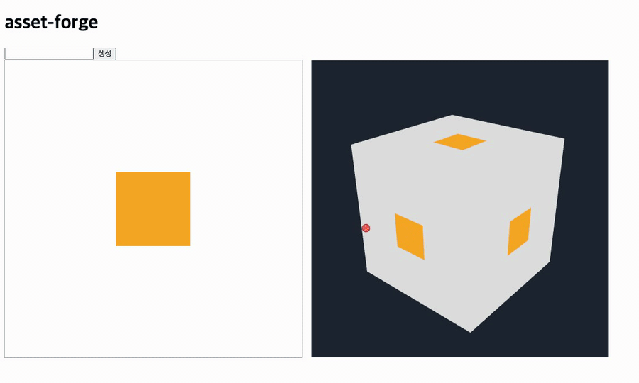

# asset-forge

생성형 AI 게임 에셋을 브라우저에서 편집하고, 3D로 바로 확인하고, 여럿이 동시에 만지는 미니 에디터.



데모: https://asset-forge-rose.vercel.app (협업은 "협업 방 만들기"를 누르고 "링크 복사"로 주소를 공유한다. 같은 주소를 연 사람끼리 문서를 함께 편집한다)

서버는 Render 무료 플랜이라 15분간 요청이 없으면 잠든다. 첫 생성·협업 연결은 수십 초 걸릴 수 있다.

## 기능

- **E1 캔버스 편집**: 레이어를 드래그·리사이즈·회전하고, 삭제 버튼이나 Delete 키로 지운다.
- **E2 실시간 프리뷰**: 캔버스 수정이 Three.js 3D 프리뷰 텍스처에 바로 반영된다.
- **E3 협업**: 같은 방(`?room=`)의 두 탭이 Yjs로 같은 문서를 동시에 편집한다.
- **E4 AI 생성**: 프롬프트로 만든 이미지가 캔버스 중앙에 레이어로 추가되고 바로 선택된다.
  공개 데모는 무료 API(pollinations.ai)를 쓰며 IP당 45초에 1장 한도가 있어, 한도·장애 시 프롬프트 글자가 적힌 목 이미지로 대체된다.
  **프롬프트는 이미지 생성을 위해 해당 제3자 API로 전송된다.**

## 실행

Node 22.12 이상.

```sh
npm install
npm start        # 터미널 1: 서버 (WebSocket + AI 프록시), 포트 8787
npm run dev      # 터미널 2: 프론트 개발 서버
```

협업은 "협업 방 만들기"를 누르거나 두 탭에서 같은 `/?room=<이름>`을 연다. `room`이 없으면 서버 없이 로컬 문서로 동작한다.

게이트 4종:

```sh
npx playwright install chromium   # 최초 1회
npx tsc --noEmit
npm run lint
npx vitest run
npx playwright test
```

## 아키텍처

| 모듈 | 역할 |
|---|---|
| `src/core/` | 순수 TS. 문서 모델(`DocStore`), 변환, 히트테스트 |
| `src/sync/` | Yjs 문서 ↔ core 모델 바인딩, y-websocket 연결 |
| `src/canvas/` | 2D 에디터 (Canvas2D). core만 참조 |
| `src/preview/` | Three.js 3D 프리뷰. core만 참조 |
| `src/ai/` | 생성 패널. 서버 프록시만 호출 |
| `src/app/` | 화면 조합. 여러 모듈을 합치는 유일한 곳 |
| `server/` | y-websocket 서버 + AI API 프록시. 계약은 `server/protocol.ts` |

canvas와 preview는 서로를 모르고 `DocStore` 구독으로만 이어진다. 그래서 W-05에서 인메모리 스토어를
Yjs로 바꿀 때 canvas·preview 코드는 한 줄도 바뀌지 않았다(PR #8). 이 경계는 ESLint
`no-restricted-imports`로 강제한다.

## 환경변수

| 위치 | 변수 | 기본값 | 설명 |
|---|---|---|---|
| 서버 | `PORT` | `8787` | 리슨 포트 |
| 서버 | `AI_PROVIDER` | (없음) | `pollinations`: 키 없는 무료 API(실패 시 목으로 대체) / `openai`: `AI_API_KEY` 필요 / 그 외·미설정: 목 |
| 서버 | `AI_API_KEY` | (없음) | `openai`일 때만 필요. 서버 전용. `server/.env`(`server/.env.example`을 복사) 또는 호스트 환경변수 |
| 서버 | `RATE_LIMIT_PER_MIN` | `10` | IP당 분당 생성 요청 수 |
| 프론트 | `VITE_SERVER_URL` | `http://localhost:8787` | 빌드 시 읽는 서버 주소 |

로컬 기본은 목 공급자(SVG 이미지)다. 공개 데모(Render)는 `render.yaml`에서 `AI_PROVIDER=pollinations`로 둔다.

## 배포 (사람이 할 일)

1. Render에 레포 연결 (`render.yaml` 자동 인식)
2. (선택) `AI_PROVIDER`는 `render.yaml`이 관리한다. 공급자를 바꾸려면 `render.yaml`을 고치고, `AI_API_KEY`만 Render 대시보드에서 입력
3. Vercel에 레포 연결, 환경변수 `VITE_SERVER_URL`에 Render 서비스의 https 주소 입력(끝에 `/` 없이)
4. 배포

## 에이전트 하네스와 측정 수치

오케스트레이터(메인 세션)는 코드를 쓰지 않고 test-writer → implementer → reviewer → qa
서브에이전트를 순서대로 호출한다. 에이전트마다 쓰기 권한을 나누고, git 훅·Claude 훅·CI가 규칙을
강제한다([docs/harness.md](docs/harness.md), [docs/conventions.md](docs/conventions.md)).

W-01~W-07은 2026-11-25 하루, 시작부터 마지막 머지까지 약 2시간 46분(14:49~17:35 KST)에 끝났다.
아래 수치는 PR #10 머지 시점 기준이다(이후의 배포·문서 갱신 PR 제외).
계획 기한은 12/16이었다.

| 작업 | PR | 시작→머지 | 커밋 | 변경 줄 (lock 제외 근사) |
|---|---|---|---|---|
| W-01 세팅 | #4 | 38분 | 9 | 약 240 |
| W-02 캔버스 | #5 | 29분 | 6 | 360 |
| W-03 프리뷰 | #6 | 17분 | 3 | 143 |
| W-04 실시간 반영 | #7 | 15분 | 3 | 171 |
| W-05 협업 | #8 | 20분 | 5 | 367 |
| W-06 AI 생성 | #9 | 36분 | 7 | 331 |
| W-07 통합·배포 준비 | #10 | 37분 | 9 | 약 240 |

W-02∥W-03, W-05∥W-06은 worktree를 나눠 병렬로 진행했다.

- **사람이 직접 고친 코드**: 0줄(0%). 사람의 개입은 W-01의 타입·프로토콜 초안 승인 1회와
  배포 계정 연결(Render·Vercel).
- **CI `gate` 실패**: 7개 PR 중 0회.
- **로컬 훅 차단**: 4회. 모두 한 명령에 `rm -rf`나 `--base main`을 `git push`와 묶어 생긴 가드
  오탐이었고, 명령을 나눠 해결했다(우회 없음).
- **reviewer 차단 지적**: 1건(W-01 ESLint 경계 누락 → 수정). **qa 실패**: 0건.
- **CodeRabbit 지적**: 12건. 10건 수정, 2건은 근거를 답글로 남기고 미반영(터치 지원·방어 복사).
  PR #6·#7·#8은 CodeRabbit 리뷰가 끝나기 전에 자동 머지되어 리뷰를 받지 못했다.
- **테스트**: Vitest 57개, Playwright E2E 6개(smoke, E1~E4, preview). 구현 약 600줄, 테스트 약 680줄.
  (현재는 아래 "이후 작업" 참고)
- **커밋**: 42개(W-01~W-07) 중 test 10, feat 13, fix 4. 모든 작업에서 test 커밋이 feat보다 먼저.

### 이후 작업

같은 방식(재현·실패 테스트 먼저 → 구현 → reviewer·qa → PR)으로 이어서 진행했다. CI `gate` 실패는 없었다.

| 작업 | PR | 내용 |
|---|---|---|
| 배포 | #11 | Render·Vercel 공개 배포 후 데모 URL 기입 |
| W-08 버그 수정 | #12 | 핸들 가장자리를 잡으면 튀던 문제, 캔버스 밖에 놓은 레이어를 다시 못 잡던 문제 |
| W-09 에디터 다듬기 | #13 | 생성 직후 새 레이어 선택, 레이어 삭제, 리사이즈로 중심이 문서 밖으로 나가지 않게 |
| W-11 데모 다듬기 | #14 | 생성 대기 표시·Enter 제출, 한국어 에러 문구, 협업 방 만들기·링크 복사 |
| W-10 무료 이미지 공급자 | #15 | 키 없는 무료 이미지 공급자와 목 대체 |

현재 테스트는 Vitest 73개, Playwright E2E 14개다. 구현 약 680줄, 테스트 약 1,010줄.

## 알려진 한계

- 서버 문서는 인메모리다. 탭이 모두 닫히면 사라진다.
- 실제 OpenAI 경로는 키가 없어 fetch 스텁 단위 테스트로만 검증했다.
- 무료 API는 워터마크가 들어가고 품질·가용성이 일정하지 않다(직접 호출 4회 중 1회 503).
- 레이트 리밋은 remoteAddress 기준이라 프록시 뒤에서는 공용 한도가 된다.
- 생성 이미지는 data URL로 Yjs 문서에 들어가므로 큰 이미지에 부적합하다.
- 캔버스 요소 밖으로 나간 핸들은 잡을 수 없다(몸통을 끌어 안으로 옮기면 된다).
- 선택 상태는 탭마다 로컬이다.
